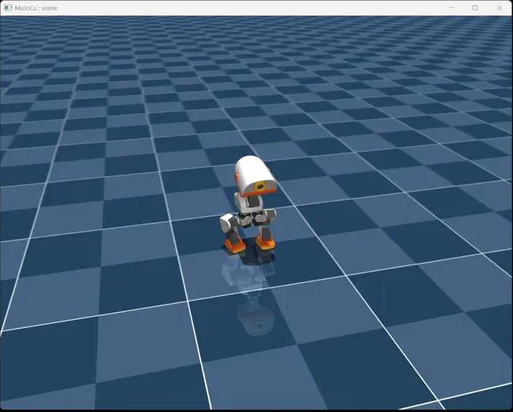

# Microduck Action Pack — Rhythm Dance (Nod & Shake)

An **English summary** of [README.md](README.md) for the pollen-robotics/microduck_rl
community. Command-level motion only: no new policy, no direct joint control — the
sequence drives the `head_pose` and `body_pose` command channels and the policy keeps
the robot balanced by itself.

## Demo



*15-second loop (played at ×2 speed). Full details below.*

---

## Files

| File | Purpose | Required? |
|---|---|---|
| `actions/nod_and_shake.json` | The motion: 27-step rhythm dance (nod ±0.6 rad, head-shake ±1.2 rad, 3 full cycles, closed loop) | ✅ |
| `squat.onnx` | Stand policy that makes the `body_pose` z channel actually work — see below | Only if you want crouch/extend |
| `infer_policy_patched.py` | Upstream `scripts/infer_policy.py` + `--sequence` playback support | ✅ |
| `README.md` / this file | Documentation | — |
| `LICENSE`, `LICENSE-MODELS.md` | Upstream licenses (Apache-2.0 code, CC BY-NC-SA 4.0 assets) | — |

---

## Why is there a `squat.onnx`? (normally you would not need it)

**Short answer:** head-only motions (nod / shake / tilt) work with the official
stand or walking policy — *no* `squat.onnx` required. You only need it if you want
the `body_pose` **z** command (crouch / extend) to do anything.

**Long answer:** microduck policies are command-conditioned, with a 13-D command
block `[twist 3] + [head_pose 4] + [body_pose 6]`. But the official StandUp /
Velocity tasks **delay-enable the `body_pose` channel**:

| Iterations | `body_pose_tracking` weight | z range |
|---|---|---|
| 0–2499 | **0 (disabled)** | ±5 mm |
| 2500 | 1.5 | −10 / +5 mm |
| 3000 | 3.0 | −18 / +8 mm |
| 4000 | **4.0** | **−40 / +30 mm** |

So a checkpoint trained for 1000–2000 iterations has **never seen a body command**:
pressing crouch in `infer_policy.py` does nothing (measured: a −40 mm command
produced −1.8 mm of actual motion).

`squat.onnx` is a purpose-trained stand policy that fixes exactly that:

- built on a custom `Mjlab-Squat-Flat-MicroDuck` task;
- compresses the body-z curriculum into the first 300 iterations (800 total);
- locomotion rewards removed (feet may stay planted), z-only height tracking;
- measured: **−40 mm command → −40.0 mm actual**, zero falls.

**One-liner:** `squat.onnx` is *not* "another walking policy" — it is "the only
stand policy where crouch commands actually do something". Delete it and use the
official StandUp if you don't need vertical body motion.

---

## Quick start

```bash
uv sync
cp action_share/squat.onnx .
cp action_share/infer_policy_patched.py scripts/infer_policy.py   # back up the original first
cp -r action_share/actions .

uv run scripts/infer_policy.py \
    --standing squat.onnx \
    --walking output.onnx --roulade roulade.onnx \
    --new-cmd-obs \
    --sequence actions/nod_and_shake.json
```

- Press **`1`** → start looping (default ×2 speed, ~6.8 s per cycle)
- Press **`1`** again → stop immediately (commands zeroed, keyboard control back)

Sequence flags: `--sequence`, `--sequence-speed` (default 2.0), `--sequence-loop`,
`--sequence-key` (default `1`), `--sequence-auto`.

---

## Writing your own sequence

```json
{ "name": "my move", "step_dt": 0.5,
  "steps": [
    {"head": {"yaw": 0.4, "pitch": 0.3}},
    {"head": {"yaw": -0.4}, "body": {"z": -0.03}},
    {"head": {"yaw": 0.0, "pitch": -0.3}}
  ] }
```

1. Every value is a **relative increment** to the previous step (not an absolute angle);
2. Multiple channels inside one step act **simultaneously**;
3. **The cycle must close**: cumulative head and body values must return to 0;
4. Units: **rad** for angles, **m** for positions (`0.030` = 30 mm);
5. Steps are smoothstep-interpolated over `step_dt` — no jumps.

Safe envelope measured on the squat policy (800 iters):

| Channel | Safe command range | Note |
|---|---|---|
| `head.pitch` | ±0.80 | ±1.2 falls (10/150 steps); +1.222 is the mechanical stop |
| `head.yaw` | ±1.20 | 1.2 still stable, tracking 66% (≈45° actual) |
| `head.roll` | ±0.30 | mechanical limit ±0.4363 (±25°) |
| `head.neck` | −1.9 ~ +0.65 | mechanical max +0.698 |
| `body.z` | −0.040 ~ +0.030 m | −40 mm = full crouch |
| `body.x/y` | ±0.005 m | alive-noise range |
| `body.roll/pitch/yaw` | ±0.26 rad | 15° |

---

## What the patch changes

Only sequence playback, five places:

1. new argparse flags (`--sequence*`);
2. pre-accumulate relative increments into absolute command targets;
3. per-step smoothstep interpolation into `policy.head_offset` / `policy.body_cmd`;
4. toggle key branch (start / immediate stop);
5. loop clock wrap + one-shot auto-release.

Inference, observation construction, BAM actuators, delays and noise are untouched.

---

## License

- **Code** — Apache-2.0 (pollen-robotics/microduck_rl), original notices retained;
- **3D assets / MJCF** — CC BY-NC-SA 4.0 (non-commercial, attribution, share-alike);
- **`squat.onnx`** — derivative model trained on the above, provided for
  **non-commercial research only**;
- **`actions/*.json`** — free to use and modify.

## Known limitations

1. Tracking is not 100% — larger commands track worse (yaw 1.2 → 0.79 actual);
2. At ×2 speed large motions outrun the policy and look like small jitter;
3. Head-only motions don't need `squat.onnx`; body-z does;
4. On hardware, firmware must support the 13-D command layout and the ONNX export
   (normalizer baked in).
